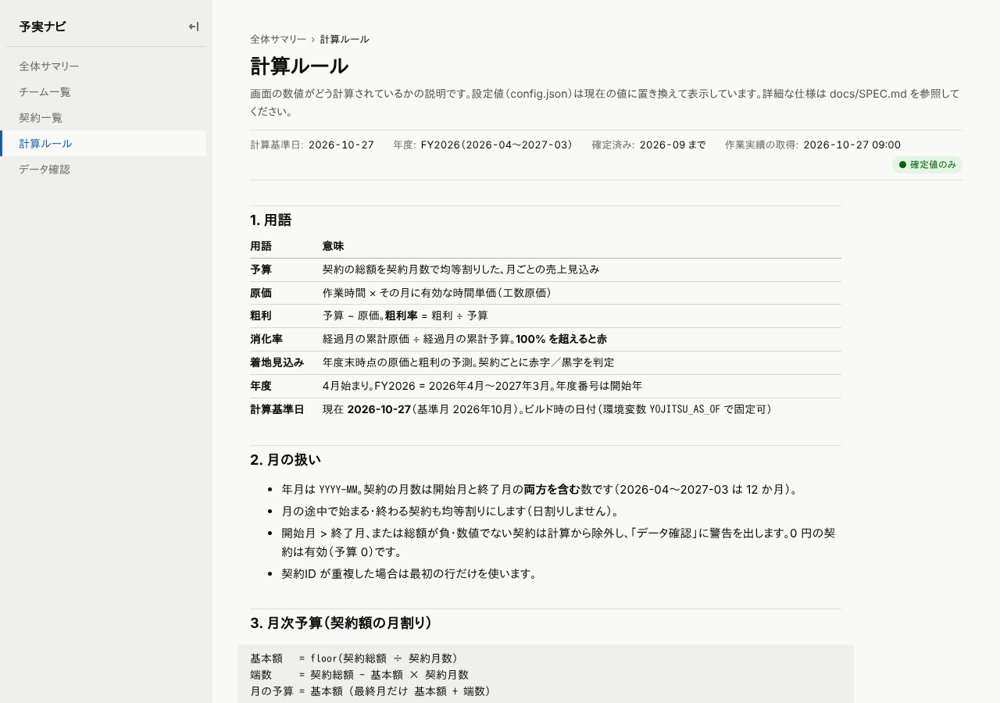

# 予実ナビ

保守契約の **予実（予算 vs 原価）と粗利** を見るための社内ダッシュボードです。
契約総額を月割りした「予算」と、作業実績 × 時間単価で求めた「原価（工数原価）」を突き合わせ、
チーム・契約ごとの消化率と年度末の着地見込み（赤字／黒字）を表示します。

- 静的サイト（[Observable Framework](https://observablehq.com/framework/)）。サーバ不要、社内 GitLab Pages に公開
- データは CSV（`data/`）。Git で履歴管理し、CI で検証してから公開
- 計算仕様は [docs/SPEC.md](docs/SPEC.md)、データ定義は [docs/DATA.md](docs/DATA.md)

## 画面

| パス | 内容 |
|---|---|
| `/` 全体サマリー | 年度・期間を選び、予算／原価／粗利／消化率と月次推移、着地見込み |
| `/teams` チーム一覧 | 組織階層（事業部 > 課 > チーム）ごとの集計。配下の合計を上位に積み上げ |
| `/contracts` 契約一覧 | 契約ごとの予実と消化率。赤 = 消化率 100% 超 or 着地赤字 |
| `/rules` 計算ルール | 画面の数値がどう計算されているかの説明 |
| `/data-check` データ確認 | 未紐付けの作業実績、単価なしメンバー、警告の一覧 |

数値をクリックすると「式 ＋ 実際に使った値」の内訳が開きます。

`/contract?id=C008` 契約詳細（契約一覧・赤字見込み一覧の行から遷移）は、月ごとの予実・メンバー別の原価・3 方式の着地見込み・元の作業ログまで辿れます。

### 画面のスクリーンショット

| 全体サマリー | チーム一覧 |
|---|---|
|  |  |

| 契約一覧 | 契約詳細 |
|---|---|
|  |  |

| 計算根拠（内訳パネル） | データ確認 |
|---|---|
|  |  |

| 計算ルール | ダークモード | スマートフォン幅 |
|---|---|---|
|  |  |  |

画面の構成・状態管理・ページの追加方法は [docs/UI_NOTES.md](docs/UI_NOTES.md) を参照。
期間・チーム・単位・着地方式は URL クエリ（`?from=2026-04&to=2027-03&team=T111&unit=k&method=recent3`）に入るので、URL を共有すると同じ表示を再現できます。

## ローカルで動かす

```bash
npm install
npx tsx scripts/generate-dummy.ts   # ダミーデータを data/ に生成（初回・デモ用。seed 固定で毎回同じ）
npm run fetch                       # 任意: 作業実績を取り直す（config.json の adapter に従う）
npm run fetch:members               # 任意: 所属・役職を人事データから取り込む（memberSource を設定したとき）
npm run validate                    # データ検証（CI と同じ）
npm run dev                         # http://localhost:3000
```

その他:

```bash
npm run check        # typecheck + validate + test をまとめて
npm run test         # vitest（unit / property / integration）
npm run build        # dist/ に静的サイトを生成（YOJITSU_AS_OF=2026-10-27 で計算基準日を固定できる）
npx tsx scripts/generate-dummy.ts --seed 7 --asOf 2026-06-15   # 別シナリオで生成
```

Node 22 以上。

## データファイルの編集ルール

ファイルの一覧と列は [docs/DATA.md](docs/DATA.md) を参照。文字コードは UTF-8（BOM 可）。Excel で保存した Shift_JIS も読めます。

- **履歴は行を追加、上書きしない**
  `teams.csv` / `members.csv` / `rates.csv` は `effective_from`（適用開始月）付きの履歴です。
  単価改定・昇格・異動・組織変更は、**新しい `effective_from` の行を追加**してください。
  既存行を書き換えると過去月の計算が変わってしまいます。
- 契約は 1 行 1 契約。更新契約は別の `contract_id` で行を追加し、`mapping.csv` にもその契約への紐付け行を足します
  （同じ顧客・案件名でも、作業日の月が契約期間に入るものに自動で振り分けられます）。
- `mapping.csv` の案件名を空にすると、その顧客の全工数が紐付きます。
- 名称の照合は正規化してから行うので、`株式会社` の有無・全角半角・前後の空白の違いは吸収されます（[docs/SPEC.md §4](docs/SPEC.md)）。
- 編集したら `npm run validate` で確認。CI でも同じ検証が走り、エラーがあると公開されません。
- `data/worklogs/YYYY-MM.csv` はアダプタが書き換えるので手で編集しないでください（csv アダプタ運用のときは例外）。

## デプロイ（GitLab Pages）

`.gitlab-ci.yml` のパイプラインは `validate → test → build → pages` です。

1. push / MR でデータ検証・テスト・ビルドが走る
2. 既定ブランチでは `pages` ジョブが `dist/` を `public/` として公開する
3. 公開 URL は `https://<group>.pages.<社内ドメイン>/<project>/`（サブパス配信を前提に相対パスでビルド）

必要な CI/CD 変数（Settings > CI/CD > Variables）:

| 変数 | 用途 |
|---|---|
| `WORKLOG_API_TOKEN` | 作業実績 API のトークン（http アダプタ）。Masked にする |
| `MEMBER_FETCH_ENABLED` | 任意。`1` でスケジュール実行時に `fetch-members` ジョブも動く（既定は無効） |
| `MEMBER_API_TOKEN` | 任意。人事 API のトークン（`memberSource.adapter = http`）。Masked にする |
| `GIT_PUSH_TOKEN` | スケジュール実行で `data/worklogs` を書き戻すための Project Access Token（Developer / `write_repository`） |
| `NPM_CONFIG_REGISTRY` | 任意。社内 npm ミラーの URL |
| `PLAYWRIGHT_E2E` | 任意。`1` で build 後に E2E も実行 |

スケジュール（Settings > CI/CD > Schedules、例: 平日 06:00）を登録すると `fetch-worklogs` ジョブが
直近 N か月の作業実績を取り直してコミット＆プッシュし、その push で通常パイプラインが走って公開まで進みます。

## 作業実績の取得元（アダプタ）を本番 API に切り替える

作業実績の取得元は `scripts/adapters/` のアダプタで差し替えます。`config.json` の `worklogSource` で選びます。

| adapter | 用途 |
|---|---|
| `csv` | `data/worklogs/*.csv` を手で置く運用（既定） |
| `dummy` | 開発・デモ用。`scripts/generate-dummy.ts` のシナリオを生成 |
| `http` | 社内の工数管理 API から JSON / CSV で取得（汎用） |

本番 API に切り替える手順:

1. `config.json` を編集

   ```json
   "worklogSource": {
     "adapter": "http",
     "http": {
       "url": "https://worklog.example.local/api/export?from={from}&to={to}",
       "authHeader": "Authorization",
       "refetchMonths": 3,
       "columns": {
         "date": "work_date", "memberId": "emp_no", "memberName": "emp_name",
         "customerName": "client", "projectName": "project", "task": "task", "hours": "hours"
       }
     }
   }
   ```

   - `{from}` `{to}` は `YYYY-MM` に置換されます
   - `columns` は「予実ナビの項目名 → 取得元の列名」
   - 任意項目: `dataPath`（JSON で配列が入っているキー。`"data.items"` のようにドット区切り）、
     `authScheme`（既定は `Authorization` ヘッダのとき `Bearer`、他のヘッダ名なら接頭辞なし）、`method`
   - 応答は `Content-Type` が JSON なら配列、`text/csv` なら CSV として読みます
   - 5xx とネットワークエラーは 3 回まで再試行、4xx は即失敗
2. CI/CD 変数 `WORKLOG_API_TOKEN` と `GIT_PUSH_TOKEN` を登録（トークンは config.json に書かない。ログにも出ません）
3. ローカルで確認: `WORKLOG_API_TOKEN=... npm run fetch && npm run validate`
4. スケジュールを登録

`refetchMonths` か月分を毎回取り直すので、締め後の修正入力も反映されます。それより前の月は触りません。
一時的に切り替えたいときは環境変数 `WORKLOG_ADAPTER=dummy npm run fetch` のように上書きできます。
新しいアダプタの追加手順は [scripts/adapters/index.ts](scripts/adapters/index.ts) の冒頭コメントを参照。

## 本番 API への合わせ方（コードを変えずに config だけで）

本番の API の列名・日付形式・ページングは本番でしか分からないので、`config.json` だけで合わせられるようにしてあります。設定項目の一覧は [docs/DATA.md](docs/DATA.md)。

1. **列名を確認する**（ファイルは書かれません）

   ```bash
   WORKLOG_API_TOKEN=... npm run fetch -- --dry-run --sample=5
   ```

   まず `config.json` の `worklogSource.adapter` を `http`、`http.url` を API の URL にしておきます。
   列名が合っていないと「列が見つかりません: …。応答の最初の1行の列名: a, b, member.id, …」と止まります
   （列名だけを表示し、中身の値は出しません）。表示された列名を見て次へ。
2. **config を書く**
   - 列名: `columns` に「予実ナビの項目 → 取得元の列名」。入れ子は `"member.id"`、候補が複数あるなら `["emp_no", "member.id"]`
   - 日付: `dateFormat`（`YYYY-MM-DD` / `YYYY/MM/DD` / `YYYYMMDD` / `ISO8601` / `epochMillis`。省略で自動判定）
   - 時間の単位: `hoursUnit`（`hours` / `minutes` / `seconds`）
   - 件数が多い API: `pagination`（`page` / `offset` / `link` / `cursor`）
   - 取り消し行などを除く: `filters`、固定の絞り込み: `query`、Shift_JIS の CSV: `encoding`
3. **もう一度 dry-run で確認する**: 「列の対応表」の各項目が `[使う列: …]` になり、先頭 N 行の日付・時間・名前が想定どおりなら完了。
   問題なければ `npm run fetch && npm run validate` で実際に書き込む。

ページングは、上限ページ数（`maxPages`、既定 1000）と、同じカーソル・同じページの繰り返しの検出で無限ループしません。
トークンはログにも例外メッセージにも出ません（環境変数のみ）。

### 所属・役職を人事データから取り込む（任意）

既定（`memberSource.adapter = "none"`）では `data/masters/members.csv` を手で編集します。
人事の元データがあるときは `memberSource` を設定すると、`npm run fetch:members` で更新できます。

```bash
# 人事の CSV を置く運用: data/hr/members.csv に置いて adapter を csv にする
npm run fetch:members -- --dry-run --sample=5   # 対応表と変更内容だけ表示（書かない）
npm run fetch:members                           # members.csv を更新
```

- 変わった人（名前・区分・役職・部・課）だけ、実行月の `effective_from` で新しい行を追加します（`team_id` は引き継ぎ。チームは画面で設定）
- 取り込み元に無い人は削除しません（退職者の過去月を壊さないため）。何度流しても同じ結果です
- 人事 API のときは `adapter: "http"`、環境変数 `MEMBER_API_TOKEN`
- CI で毎日実行するには、スケジュールを登録して CI/CD 変数 `MEMBER_FETCH_ENABLED=1` を設定します（既定は無効）

## 原価の種類を追加する

現在は工数原価（`labor`）だけです。外注費・ライセンス費などを追加する場合:

1. `config.json` の `costTypes` に `{ "id": "outsourcing", "label": "外注費" }` を追加
2. その種類の月次金額を求めるロジックを計算コア（`src/core/cost.ts`）に足し、`ContractMonth.costs[id]` に入れる
   （入力データが必要なら `docs/DATA.md` に CSV を定義し、`src/core/csv.ts` と `scripts/lib/load.ts` で読む）
3. 画面は `costs` の全キーを表示するので、追加の変更は不要（合計 `cost` は自動で合算）

## ロードマップ

初回リリース: 全体サマリー・チーム一覧・契約一覧・計算ルール・データ確認（本リポジトリ）。

2 回目以降:

- チーム詳細（メンバー別の工数・原価、月次推移）
- 顧客別の集計
- メンバー別の稼働状況（配分人月、兼務）
- 編集画面（契約・マッピング・単価を画面から編集して MR を作る）
- 作業実績 API からの自動取得の本番適用（http アダプタ）
- 月ごとの組織差分を反映した過去月集計（現在は期間終了月の組織で表示）

## リポジトリ構成

```
config.json              計算・表示・取得元の設定
data/                    CSV データ（docs/DATA.md）
docs/                    SPEC.md（計算仕様）, DATA.md（列定義）, DUMMY_DATA.md（ダミーデータのシナリオ）
scripts/
  generate-dummy.ts      ダミーデータ生成（決定的）
  fetch-worklogs.ts      作業実績の取得（直近 N か月を書き換え）
  validate-data.ts       データ検証（CI）
  fetch-members.ts       所属・役職の取り込み（members.csv に追記）
  adapters/              作業実績アダプタ（csv / dummy / http）とメンバー取り込み（members.ts）
  lib/                   Node 用の補助（文字コード判定、CSV、読み込み）
src/core/                計算コア（純粋関数。画面に依存しない）
src/*.md                 画面（Observable Framework）
src/components/          画面の部品（KPI・表・グラフ・内訳パネル・フィルタ・状態管理）
src/data/                データローダ（model.json / worklogs/[contractId].json / dataset-issues.json）
src/style.css            デザイントークンとスタイル（ライト／ダーク）
tests/                   unit / property / integration / e2e
```
