# 予実ナビ

保守契約の **予実（予算と実績）と残予算** を見るための社内ダッシュボードです。
契約総額を月割りした「予算」と、作業実績 × 時間単価で求めた「実績」を突き合わせ、
組織・顧客・案件・メンバーごとの消化率と年度末の着地見込み（超過／範囲内）、工数の内訳を表示します。

- 静的サイト（[Observable Framework](https://observablehq.com/framework/)）。サーバ不要、社内 GitLab Pages に公開
- データは CSV（`data/`）。Git で履歴管理し、CI で検証してから公開。マスタは画面で編集して GitLab に MR を作る
- 画面の文言は `src/i18n/` にまとめてあり、プログラムを触らずに書き換えられます（[docs/TEXTS.md](docs/TEXTS.md)）

## 画面

上部タブ（全体・チーム・顧客・案件・メンバー・工数）と右上の補助リンク（データ確認・計算ルール・稼働計画・マスタ編集・設定）で移動します。

| パス | 内容 |
|---|---|
| `/` 全体 | 予算・実績・残予算・消化率・着地見込みの差、月次推移 |
| `/teams` → `/team?id=` チーム | 組織階層ごとの集計（配下を上位に積み上げ）→ チーム詳細（案件・メンバー別の実績・組織の変遷） |
| `/customers` → `/customer?key=` 顧客 | 顧客ごとの集計 → 顧客詳細（案件一覧・担当チーム別） |
| `/contracts` → `/contract?id=` 案件 | 案件ごとの予実（赤 = 消化率 100% 超 または 超過見込み）→ 案件詳細（月ごと・メンバー別・着地 3 方式・作業ログ） |
| `/members` → `/member?id=` メンバー | 計画と実績・稼働率 → メンバー詳細（月ごと・案件別・単価の変遷・退職） |
| `/workload` 工数 | 契約内／契約外の工数（人月）を組織・顧客・メンバー別に。作業種別の内訳 |
| `/data-check` データ確認 | 未紐付けの作業実績・単価なし・退職後の実績などの警告 |
| `/rules` 計算ルール | 画面の数値の計算方法 |
| `/plan` 稼働計画 | リーダーが組織のメンバー × 月の計画（アサイン）を入力（人月でも時間でも、保存は人月） |
| `/masters` マスタ編集 | メンバー・単価・組織・アサインを画面（表／CSV）で編集し、GitLab に MR を作る。リーダーがマージ |
| `/settings` 設定 | GitLab のトークン、テーマ（ライト／ダーク） |

数値をクリックすると「式 ＋ 実際に使った値」の計算根拠が開きます。グラフは右上の「拡大」で大きく表示できます（スマホは全画面。SPEC §33）。
期間・チーム・単位・着地方式は URL（`?from=2026-04&to=2027-03&team=T111&unit=k&method=recent3`）に入るので、URL を共有すると同じ表示を再現できます。

### スクリーンショット

ダミーデータ（[docs/DUMMY_DATA.md](docs/DUMMY_DATA.md)、計算基準日 2026-10-27）で撮影。画面を変えたら `npm run screenshots` で撮り直します。

| 全体 | 案件一覧 |
|---|---|
| 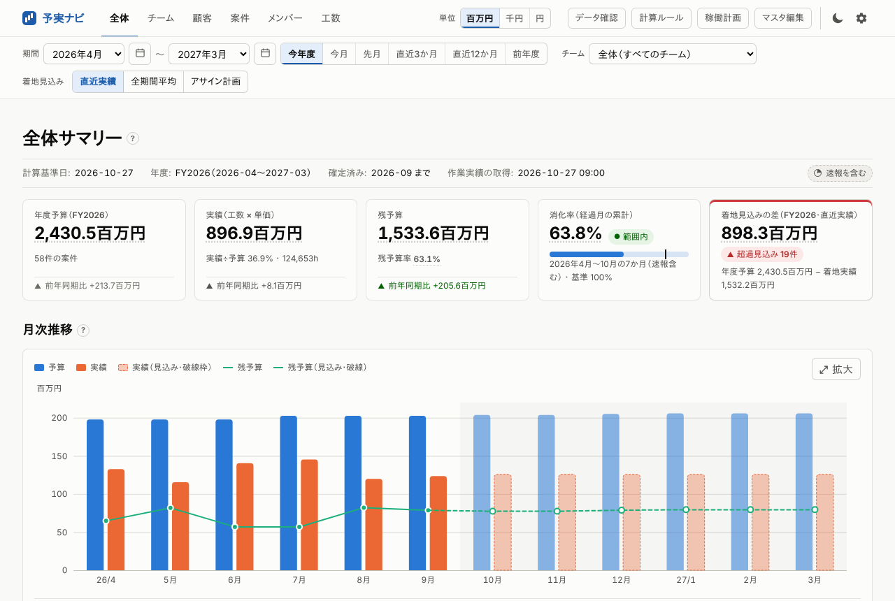 | 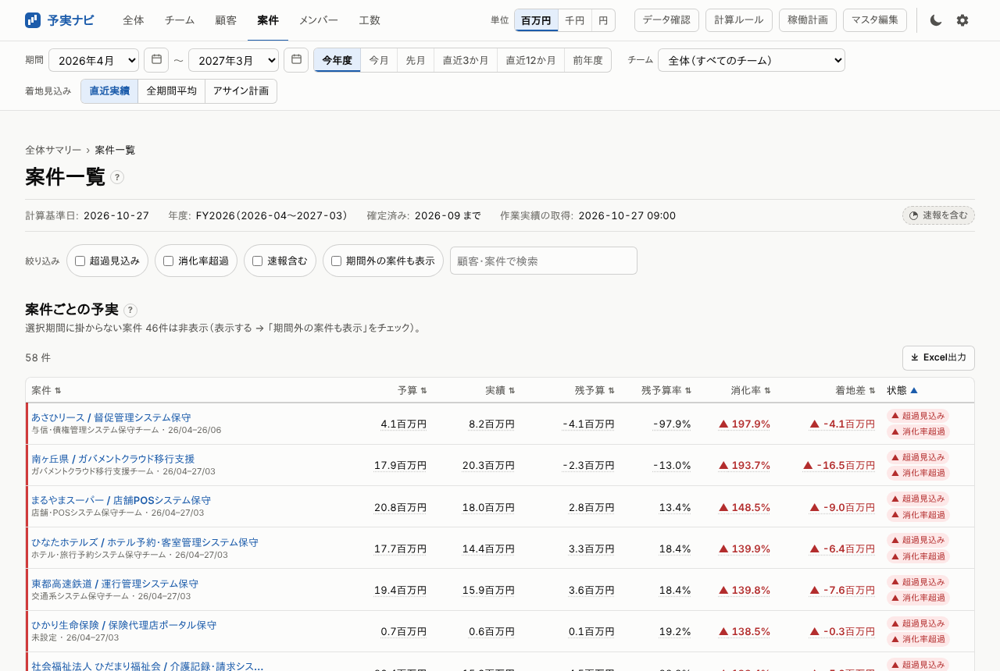 |

| チーム一覧 | 案件詳細 |
|---|---|
| 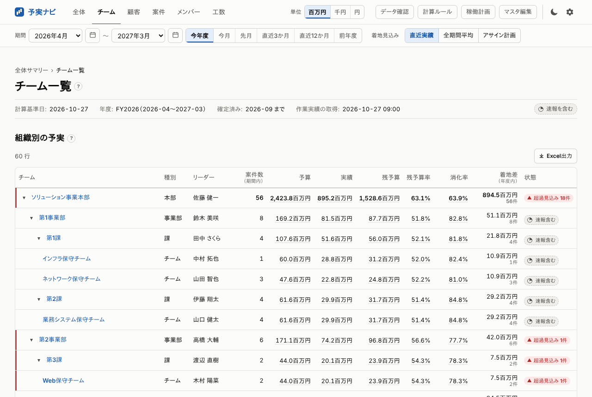 | 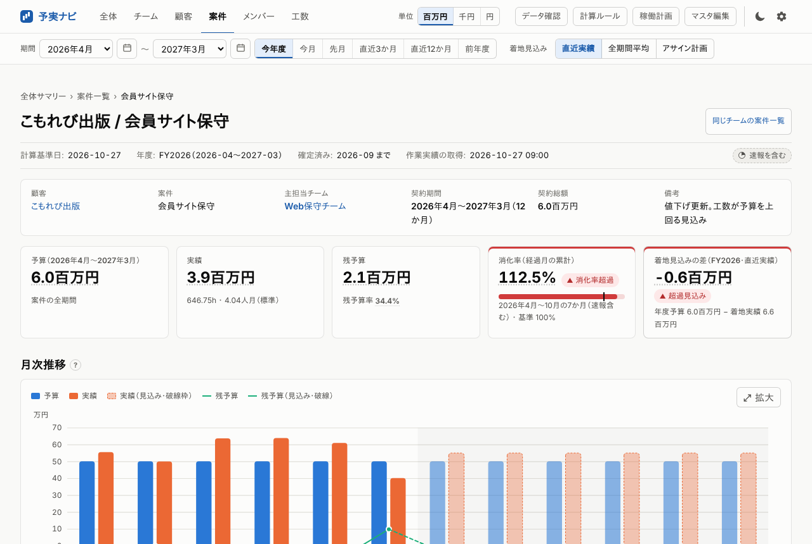 |

| 顧客一覧 | メンバー一覧 |
|---|---|
| 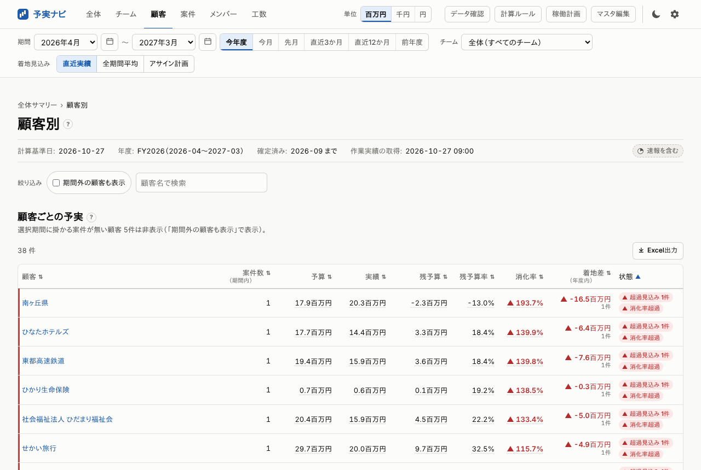 | 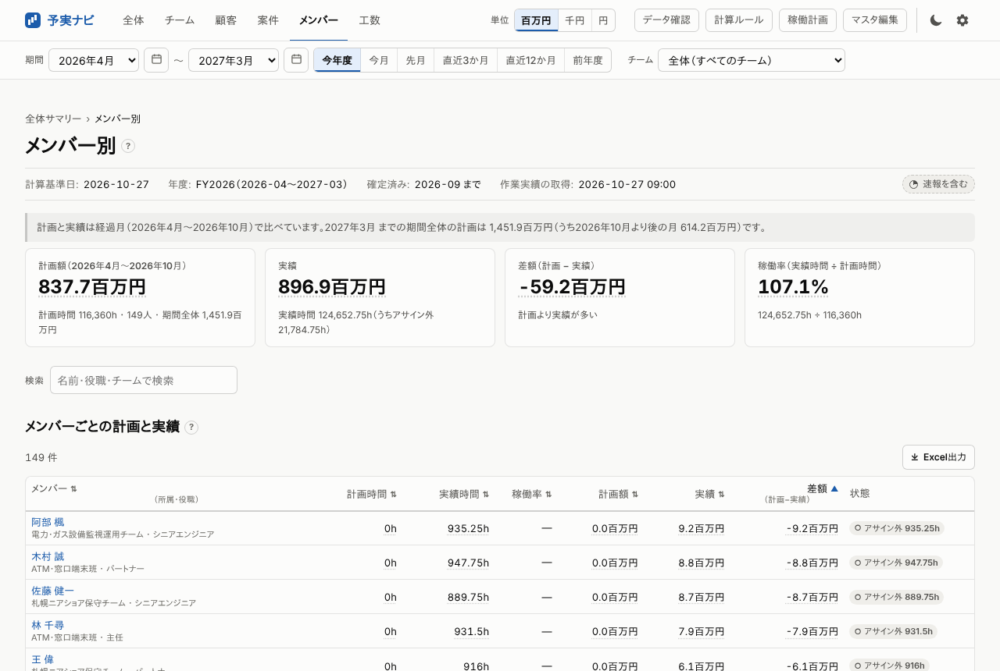 |

| 工数 | 計算根拠 |
|---|---|
| 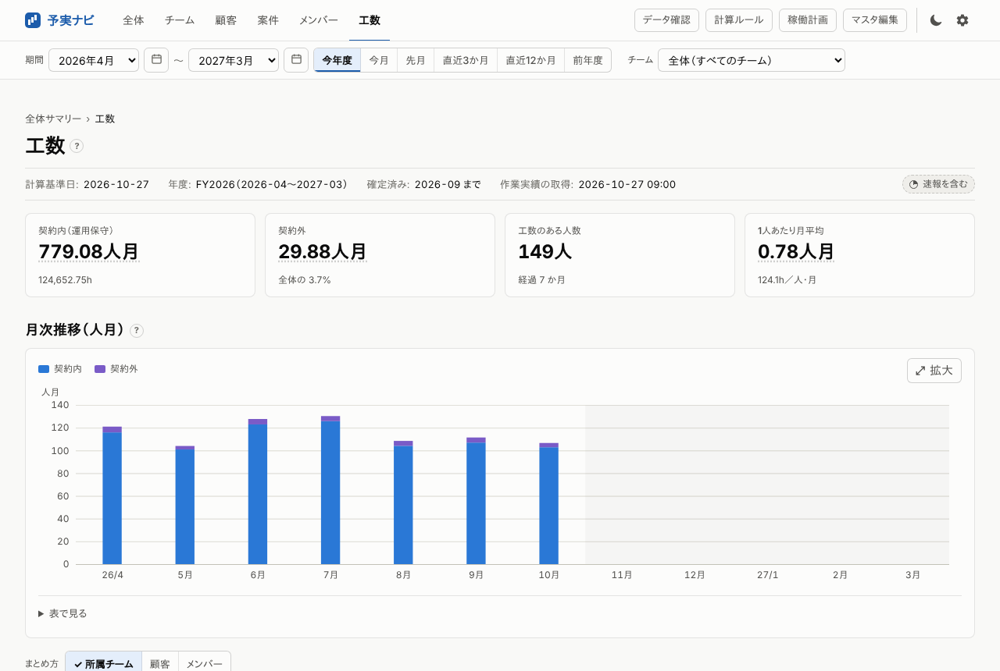 | 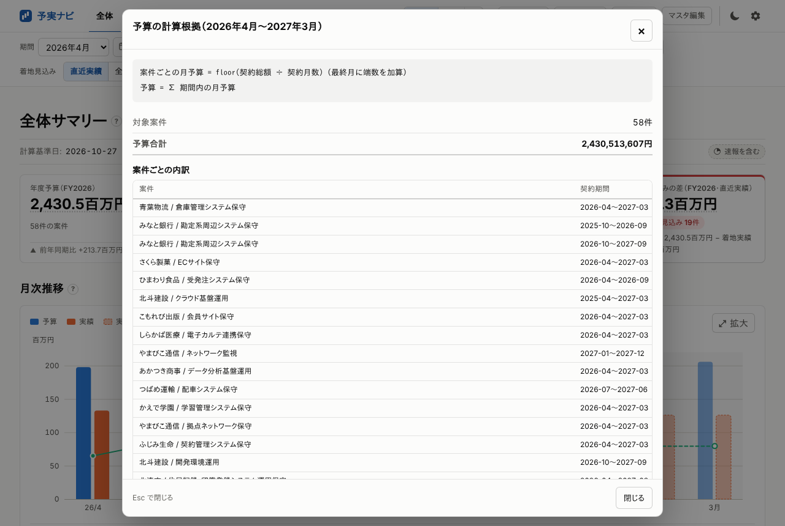 |

| 稼働計画 | マスタ編集 |
|---|---|
| 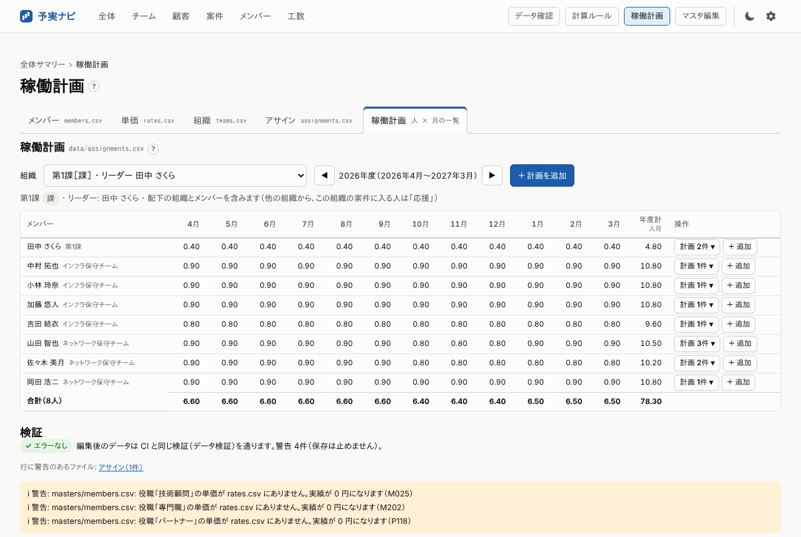 | 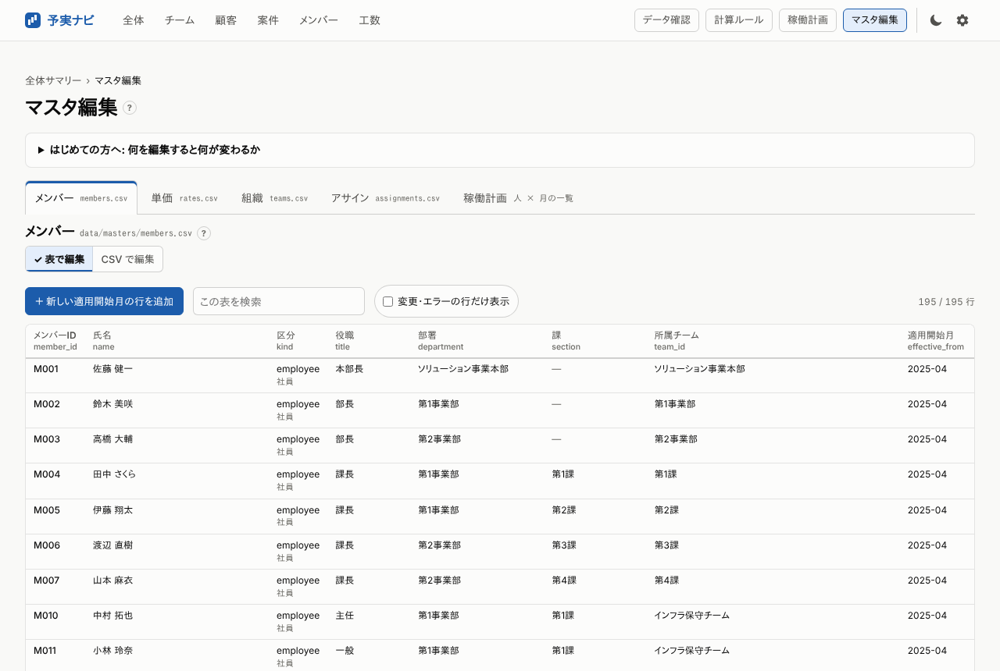 |

| データ確認 | ダーク | スマートフォン幅 |
|---|---|---|
| 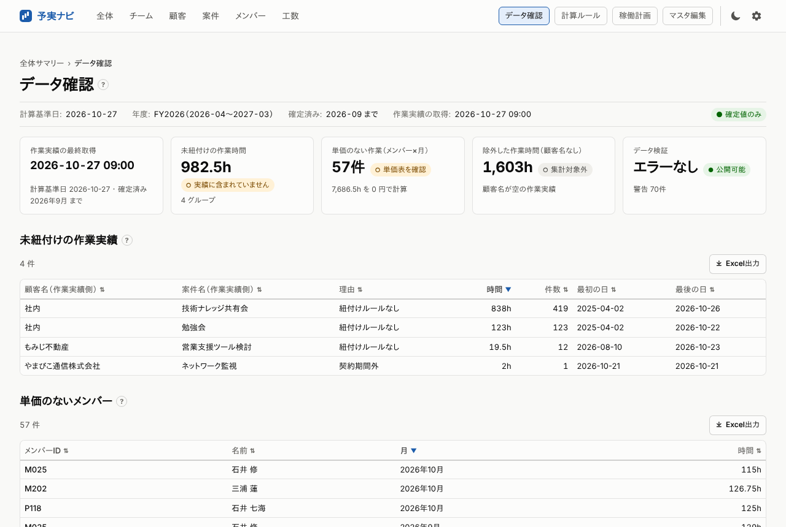 | 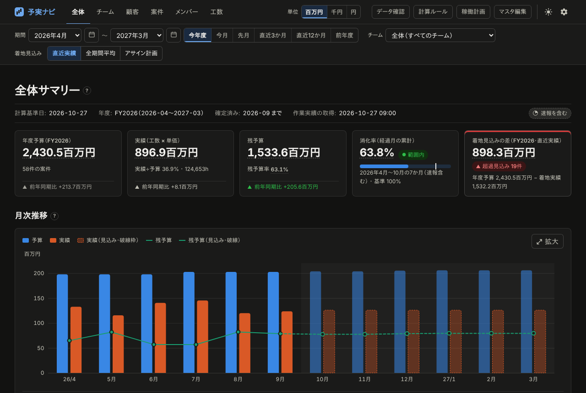 | 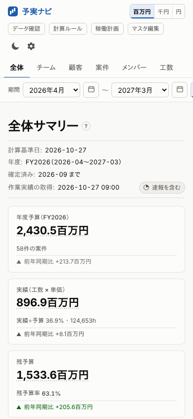 |

## ローカルで動かす

Node 20 以上（CI は Node 22）。

```bash
npm install
npx tsx scripts/generate-dummy.ts   # ダミーデータを data/ に生成（seed 固定で毎回同じ。約 10 万行）
npm run validate                    # データ検証（CI と同じ）
npm run dev                         # http://localhost:3000（data/ や config.json を変えると自動で作り直す）
```

| コマンド | 内容 |
|---|---|
| `npm run check` | 型チェック + データ検証 + テスト（unit / property / integration） |
| `npm run test:e2e` | 画面の E2E（Playwright。[tests/e2e/README.md](tests/e2e/README.md)） |
| `npm run build` | `dist/` に静的サイトを生成し、出力を検証する（`YOJITSU_AS_OF=2026-10-27` で計算基準日を固定）。古いキャッシュは自動で捨てる（[docs/DATA_LOADERS.md](docs/DATA_LOADERS.md)） |
| `npm run screenshots` | `dist/` から README のスクリーンショットを撮り直す |
| `npm run fetch` / `npm run fetch:members` | 作業実績・所属を取り込み元から取り直す（[docs/OPERATIONS.md](docs/OPERATIONS.md)） |

ビルドは必ず `npm run build` を使います（`npx observable build` を直接使うと、データを直しても古い数字のまま公開されることがあります）。

## データファイルの編集ルール

ファイルの一覧と列は [docs/DATA.md](docs/DATA.md) を参照。文字コードは UTF-8（BOM 可）。Excel で保存した Shift_JIS も読めます。

- **履歴は行を追加、上書きしない**
  `teams.csv` / `members.csv` / `rates.csv` は `effective_from`（適用開始月）付きの履歴です。
  `teams.csv` の `level`（種別: 課・チーム・班など自由入力）と `leader_member_id`（リーダー）は省略可（SPEC §21・§22）。
  単価改定・昇格・異動・組織変更・退職は、**新しい `effective_from` の行を追加**してください（退職は `members.csv` の `status` 列に `退職`。SPEC §35）。
  既存行を書き換えると過去月の計算が変わってしまいます。
- 契約は 1 行 1 契約。更新契約は別の `contract_id` で行を追加し、`mapping.csv` にもその契約への紐付け行を足します
  （同じ顧客・案件名でも、作業日の月が契約期間に入るものに自動で振り分けられます）。
- `mapping.csv` の案件名を空にすると、その顧客の全工数が紐付きます。
- 名称の照合は正規化してから行うので、`株式会社` の有無・全角半角・前後の空白の違いは吸収されます（[docs/SPEC.md §4](docs/SPEC.md)）。
- 編集したら `npm run validate` で確認。CI でも同じ検証が走り、エラーがあると公開されません。
- `data/worklogs/YYYY-MM.csv` はアダプタが書き換えるので手で編集しないでください（csv アダプタ運用のときは例外）。

## 公開（GitLab Pages）

`.gitlab-ci.yml` のパイプラインは `validate → test → build → pages` です。既定ブランチでは `pages` ジョブが `dist/` を公開します。
初回の設定（閲覧制限・メンバー・保護ブランチ・Runner）と困ったときの対処は [docs/DEPLOY_GITLAB.md](docs/DEPLOY_GITLAB.md)、
CI/CD 変数・作業実績 API への切り替え・人事データの取り込み・マスタ編集の設定は [docs/OPERATIONS.md](docs/OPERATIONS.md) にあります。
画面もビルドも外部 CDN・外部サイトに接続しません。

開発用の GitHub Actions（`.github/workflows/ci.yml`）は、`*.md`（`src/` の画面は除く）・`docs/`・`.gitlab-ci.yml` などテストに関係ないファイルだけの変更では起動しません。文書の変更では代わりに軽い検査（`docs.yml`: リンク切れ・古いスクリーンショット）だけが動きます。

## ドキュメント

| 文書 | 内容 |
|---|---|
| [docs/SPEC.md](docs/SPEC.md) | 計算と画面の仕様（実装の正） |
| [docs/DATA.md](docs/DATA.md) | データファイルの列と `config.json` の取り込み設定 |
| [docs/DUMMY_DATA.md](docs/DUMMY_DATA.md) | ダミーデータのシナリオと検証結果の期待値 |
| [docs/DATA_LOADERS.md](docs/DATA_LOADERS.md) | データローダとキャッシュの決まり（壊れた・古い出力を公開しない） |
| [docs/OPERATIONS.md](docs/OPERATIONS.md) | 運用と設定（CI/CD 変数・API・人事取り込み・マスタ編集・実績の種類の追加） |
| [docs/DEPLOY_GITLAB.md](docs/DEPLOY_GITLAB.md) | 社内 GitLab Pages への公開手順 |
| [docs/UI_NOTES.md](docs/UI_NOTES.md) | 画面の構成・状態管理・ページの追加方法 |
| [docs/CORE_NOTES.md](docs/CORE_NOTES.md) | 計算コアの実装メモ |
| [docs/TEXTS.md](docs/TEXTS.md) | 画面の文言の書き換え方 |
| [CONTRIBUTING.md](CONTRIBUTING.md) | 変更の決まり（**PR ごとにドキュメントも直す**・テスト） |

## これから

- 作業実績 API・人事 API の本番適用（列名の確認、定期取り込み）
- GitLab API 経由のマスタ保存の本番確認（CORS・保護ブランチ・トークン権限）
- 稼働計画での契約外の予定の入力（SPEC §30.5）
- 前年比（1 年分のデータがたまってから）

## リポジトリ構成

```
config.json              計算・表示・取り込み元・マスタ編集の設定
data/                    CSV データ（docs/DATA.md）
docs/                    仕様・データ定義・運用手順など（上の「ドキュメント」）
scripts/
  build.ts / dev.ts      ビルド・開発サーバ（入力の指紋でキャッシュを管理）
  verify-dist.ts         ビルド結果の検証
  generate-dummy.ts      ダミーデータ生成（基本シナリオ）。dummy-scale.ts が実運用規模の部分
  fetch-worklogs.ts      作業実績の取得（直近 N か月を書き換え）
  fetch-members.ts       所属・役職の取り込み（members.csv に追記）
  validate-data.ts       データ検証（CI）
  screenshots.mjs        README のスクリーンショット
  adapters/              取り込みアダプタ（csv / dummy / http）
  lib/                   Node 用の補助（CSV・文字コード・読み込み・原子的な書き込み・指紋）
src/core/                計算コア（純粋関数。画面に依存しない）
src/*.md                 画面（Observable Framework）
src/components/          画面の部品（KPI・表・グラフ・計算根拠・フィルタ・マスタ編集）
src/data/                データローダ（docs/DATA_LOADERS.md）
src/i18n/                画面の文言（ja.js）と計算ルール画面の本文（rules.txt）
src/style.css            デザイントークンとスタイル（ライト／ダーク）
tests/                   unit / property / integration / fuzz / e2e
```
